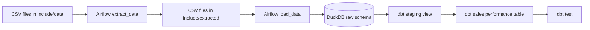

# Sales ETL Pipeline

An Apache Airflow pipeline that loads sales CSV data into DuckDB and builds analytics models with dbt. The project uses the Astro Runtime for local Airflow development.

## Data flow



The DAG is `astro_duckdb_dbt_etl` in `dags/etl_pipeline.py`. It runs daily and does not backfill prior dates. Its tasks run in this order:

1. `extract_data` copies the four input CSVs from `include/data/` to `include/extracted/`.
2. `load_data` replaces the corresponding tables in the `raw` schema of `include/sales_dw.duckdb`. The sales pipeline date fields are parsed during loading.
3. `dbt_deps` installs dbt package dependencies.
4. `dbt_run` builds the dbt models.
5. `dbt_test` runs the tests declared in the dbt project.

The dbt staging model is `stg_sales_pipeline`; the final `fct_sales_performance` model joins won opportunities to accounts, products, and sales teams.

## Project layout

| Path | Purpose |
| --- | --- |
| `dags/etl_pipeline.py` | Airflow DAG and extract/load task implementations |
| `include/data/` | Input CSV files: accounts, products, sales teams, and sales pipeline |
| `include/extracted/` | CSV copies produced by the extract task |
| `include/sales_dw.duckdb` | DuckDB database populated by the DAG |
| `include/sales_dbt/models/` | dbt staging and sales performance models and source declarations |
| `include/sales_dbt/tests/` | dbt data tests |
| `requirements.txt` | Python dependencies installed in the Astro Runtime |
| `Dockerfile` | Astro Runtime base image |

## Requirements

- Docker Desktop (or another supported Docker engine)
- Astro CLI

The Astro Runtime installs the Python dependencies listed in `requirements.txt`, including `duckdb`, `dbt-duckdb`, and `pandas`.

## Run locally

From the project root, start the Airflow environment:

```powershell
astro dev start
```

Open the Airflow UI at [http://localhost:8080](http://localhost:8080), enable `astro_duckdb_dbt_etl`, and trigger a run. The DAG is also scheduled to run daily. To stop the local environment:

```powershell
astro dev stop
```

## Run dbt manually

The dbt profile points to `/usr/local/airflow/include/sales_dw.duckdb`, the project path inside the Astro container. Run dbt from the scheduler container so this path resolves correctly:

```bash
astro dev bash
cd /usr/local/airflow/include/sales_dbt
dbt deps --profiles-dir .
dbt debug --profiles-dir .
dbt run --profiles-dir .
dbt test --profiles-dir .
```

Run the Airflow extract and load tasks first, or the dbt sources in the `raw` schema will not exist yet. The `include/sales_dbt/tests/` directory currently has no dbt tests, so `dbt test` will not validate data until tests are added.

## Notes

- The source CSVs are expected to retain their current filenames and columns.
- `include/extracted/` is an intermediate copy; the DuckDB `raw` schema is loaded from those extracted files.
- `include/sales_dbt/profiles.yml` is configured for the Astro container path. For running dbt directly on the host, use a separate local profile or override the database path rather than relying on that container-only path.
